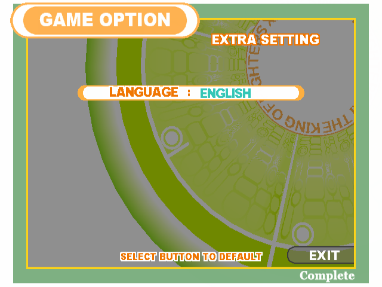
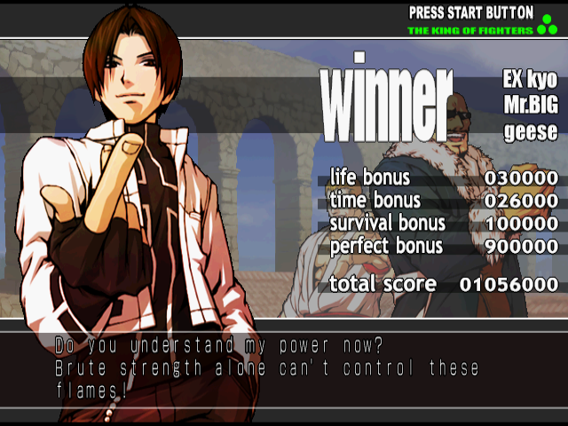
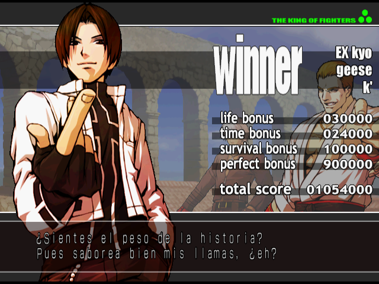
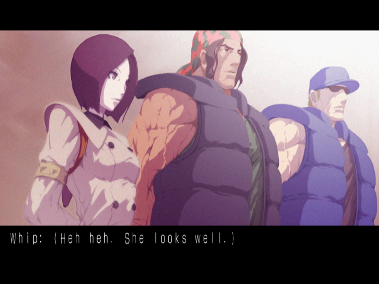
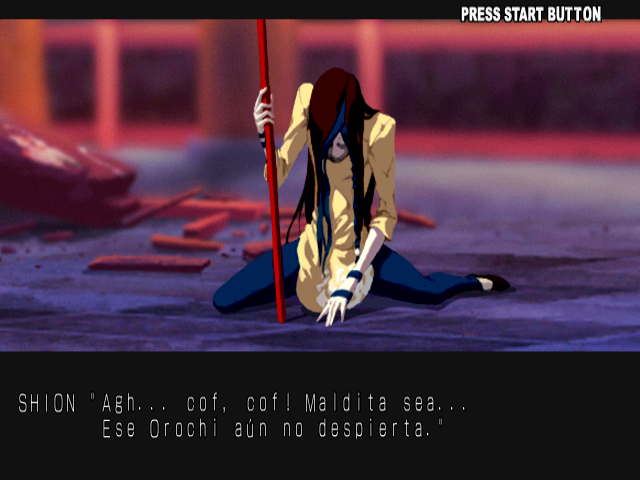
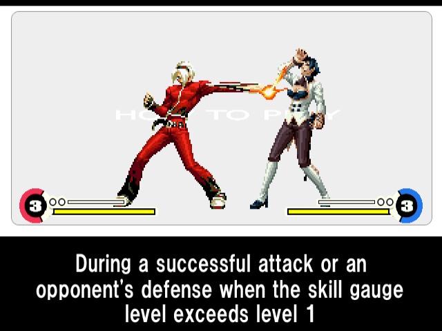
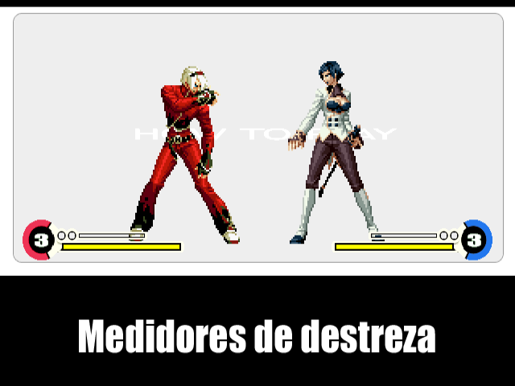
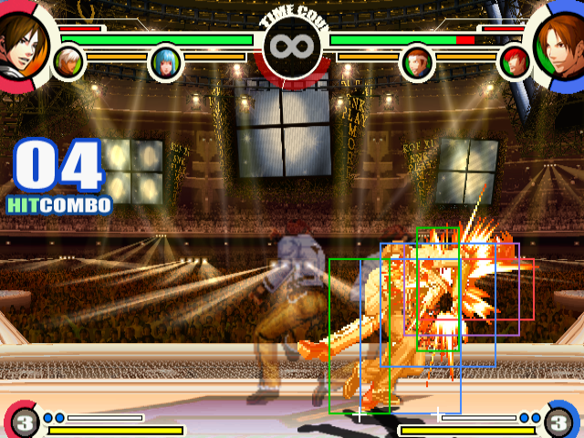
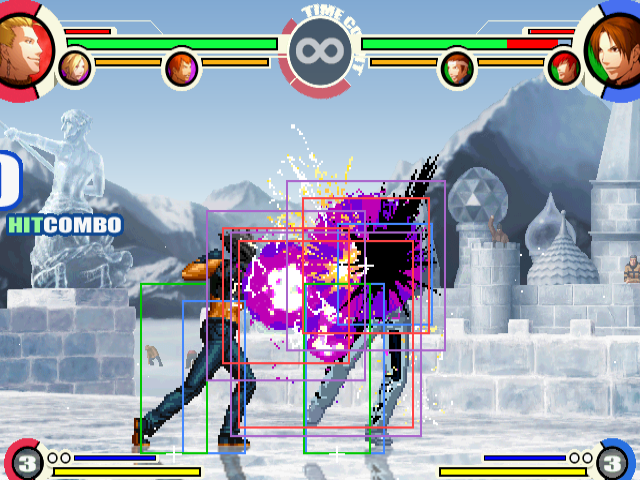

# The King of Fighters XI International

*An unofficial fan patch: English and Spanish on the Japanese disc, and a handful of restorations* -- PlayStation 2, SLPS-25660 (Japan)

## What this is

The Japanese PlayStation 2 release of The King of Fighters XI is the most complete version
of the game, and it is in Japanese only. This patch adds English and Spanish to it without
taking the Japanese away, restores a few things the port lost on its way from the arcade,
and adds a training tool. The game starts in Japanese, exactly as the original does, until
you choose another language.

 EXTRA SETTING: the language, saved with your options" title="GAME OPTION > EXTRA SETTING: the language, saved with your options">

## What it adds

**Languages**

- GAME OPTION has a new entry, EXTRA SETTING, with one setting: LANGUAGE -- Japanese,
  ENGLISH or ESPANOL. It is saved on the memory card with the rest of your options. A save
  made with the patch still loads on the original disc.
- Win quotes in English and Spanish for every character, the PS2-exclusive ones included,
  and for the first time ALL of them: see ABOUT THE TRANSLATION.
- Cutscene subtitles in English and Spanish. The English is the script of the North
  American release; the Spanish is SNK's, with its errors corrected.

**Restorations**

- HOW TO PLAY: the arcade's demonstration before character select, missing from the port,
  back in the three languages.
- Three stage fixes: the gap at the mirrored half of two stages (Different Space), a
  misplaced ground tile (Ice Festival), and the banner of the concert stage, which now
  reads THE KING OF FIGHTERS (by Keku).

**Training**

- HIT BOX: a fourth SELECT BUTTON function in PRACTICE that draws the collision boxes.

## What you need

- your own image of The King of Fighters XI (Japan), SLPS-25660, v1.03:
      King of Fighters XI, The (Japan).iso
      2,540,208,128 bytes
      sha256 3c8b0d6e986815a747755b8fac0b33c05244b66a6aec6c6f9a0e4c6eb8b0883b
  The patch is for this image only. Another dump, revision or region will not apply.
- xdelta3 (https://github.com/jmacd/xdelta/releases), or any patcher that applies
  VCDIFF / .xdelta files (Delta Patcher, for one).

## How to apply

  xdelta3 -d -s "King of Fighters XI, The (Japan).iso" KOFXI_International_PS2.xdelta "King of Fighters XI, The (Japan) [International].iso"

The result is 2,540,208,128 bytes with
      sha256 44d6bcbfb998f9382201b81d123a364e6deb3c2d72729d7d137e4e8e6424a363
Your original is not changed. The patched game runs on PCSX2 (its CRC there is DAA7A844,
so cheats and patches keyed to the original's E4BB51C1 will not load against it).

If you applied one of the earlier single patches (HOW TO PLAY, Different Space, Ice
Festival, the concert banner): this one already contains all four. Apply it to your
ORIGINAL image, not to a patched one.

Patch file: KOFXI_International_PS2.xdelta, sha256 8c43463abbfb638a424eabddf9fc54028f9e2728a577442714e5a6c6543b2677

## Credits

THE GAME AND ITS ART ARE SNK CORPORATION'S. Nothing here is licensed and none of it is ours
to hand out; this patch contains no part of the game and only works on your own copy.
NOT FOR COMMERCIAL USE. Vans is not affiliated with SNK and is not endorsed by SNK.

THE PATCH IS VANS'S: the reading of the PS2 executable and of the arcade data, the
restorations, the language setting, the new and corrected text.

The English cutscene script and the English win quotes of the PS2-exclusive characters are
SNK's own, from the North American release of the game.

The concert stage banner is Keku's (@kekutougame).

HIT BOX owes its checking to odabugs: my hitbox reading was double-checked against his
hitbox viewer, and its colors largely follow his, which are now the standard. The final
table of box kinds is read from the game itself.

Special thanks: Melody-Yoshi, whose KOF XI converter is where the disc's .lz packing was
first read from.

## About the translation

The PS2 disc carries a hidden Latin American Spanish script, left over from the Atomiswave
release: abandoned and switched off. Switched back on, it worked -- but it was a poor
translation, it had no win quotes for the PS2-exclusive characters, and, like the English,
it only translated HALF of each character's general win quotes: the other half were
copies of the first, where the Japanese has a different line for each.

Spanish: the whole script was polished, the PS2-exclusive characters' win quotes were
translated anew, and the missing half of every character's win quotes was translated for
the first time.

English: the script had already been polished by SNK for the North American PS2 release,
so it is theirs, with typos and a few mistranslations fixed. The major change is the same
missing half of every character's win quotes, translated for the first time.

None of the Spanish or English text is raw machine output. I am fluent in Japanese; every
new or corrected line was checked against the Japanese original and approved by me, with
AI assistance used for drafting.

## About ai assistance

Claude Opus 5.5 and Claude Fable 5.2 assisted in the production of this patch. I already
knew the game's data structures, and had maps of the player data (hitboxes included), years
before these tools existed. I compared what I knew against the game, used the assistance to
organize that knowledge, and whatever my own notes did not explain was new material to
learn. That pursuit is what slowly made it possible to patch the game's flaws. This
collection of patches has been in the works for more than half a year.

## Twenty years in the making

The original effort of data mining The King of Fighters XI was started by NeoGouki (JJWE)
https://ngmc.retrogames.com/ a veteran of the classic MUGEN community who was incredibly
gifted at data mining fighting games using MAME. NeoGouki taught me how to read data from
KOF XI when I was only 15 years old (2006), before the game was even playable on PCSX2.
The path was rough: the game ran poorly and it was very hardware-intensive. Many of the
concepts he taught me did not sink in until many years later.

Many friends and mentors taught me how KOF data worked on the NeoGeo. My first mentors were
David 'CCIronMUGEN' and Pharaon 'OrochiKOF97' (@FafaElLoco), who produced faithful
conversions of KOF characters for the MUGEN engine. Other colleagues who supported me
during data mining efforts were Scal 'DarkSaviour', LegendBlueShirt 'Insanius' and
Jesuszilla.

My knowledge of the game kept growing, and I became familiar with the graphics formats, the
collision box and animation formats, and a few bits and pieces of the state machines
inside. My first effort to honor what NeoGouki taught me was the first KOF XI and NGBC data
miners, released on November 26, 2017 (https://www.youtube.com/watch?v=gyWRy8RGIUA). To my
knowledge, this was the very first tool able to mine hitboxes from KOF XI and to transform
its animation data to generic formats in real time.

This patch, The King of Fighters XI International, aims to give back to the community by
improving the console version of KOF XI just a little bit -- particularly for the people
who still love the game deeply and still prefer to play it on a console, on a CRT. It was
made with care, and it has a 20-year history behind it.

## Dedication

I dedicate this patch to my dear friends:

    @KusanagiFGC (Kusanagi)
    @ViolentKain (Violent Kain)
    @Koferohonesto (Layec)
    @Cipher_Zero1 (Cipher)
    @elrosa_ (El Rosa)

who love KOF as much as I do. The memories of playing KOF together with all of them are
some of the most precious of my lifetime.

Este parche es para ustedes, amigos.

## Download

The patch and this text are in the latest release of this repository: `KOFXI_International_PS2.zip`.

## Source

`source/` says what the patch changes and why: every patched word with its purpose, commented assembly of the new routines, and the lines of text this patch wrote or changed. See `source/README.md`.

## Licence

The game is SNK's. What is the author's own here is under CC BY-NC-SA 4.0: credit required, no commercial use, share alike. See `LICENSE.md`.
